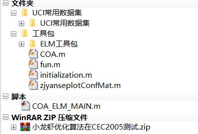
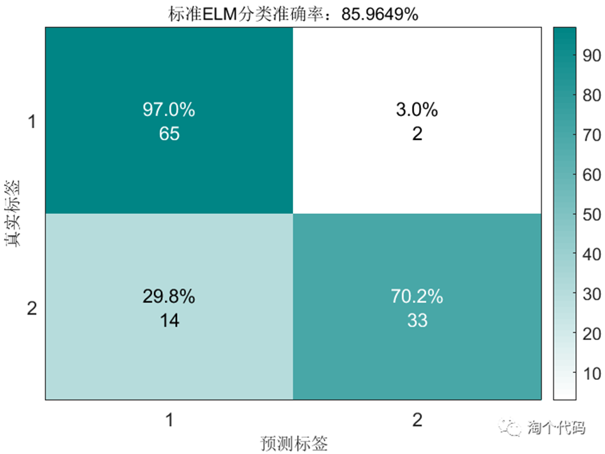
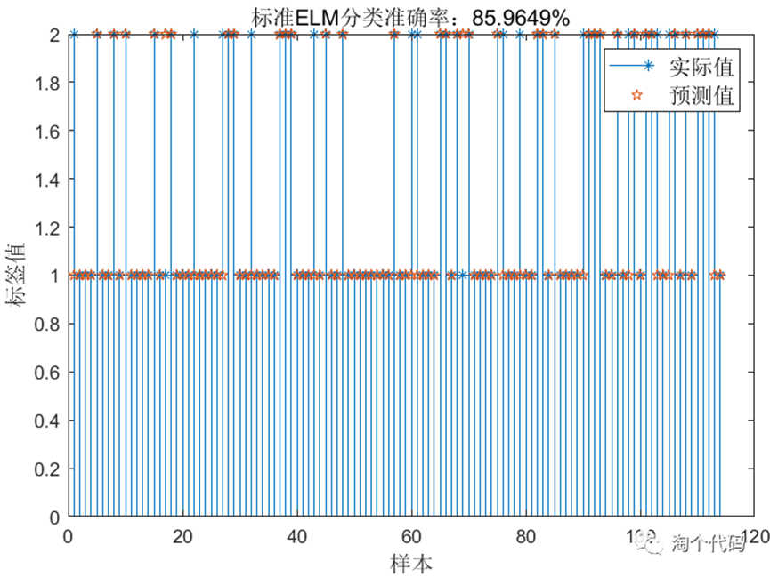
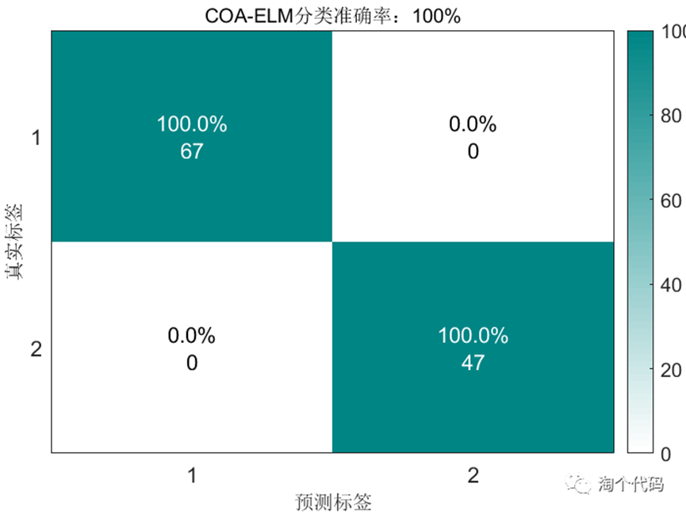
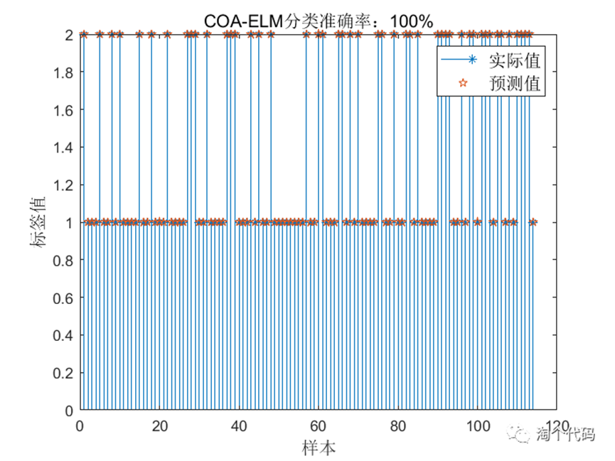
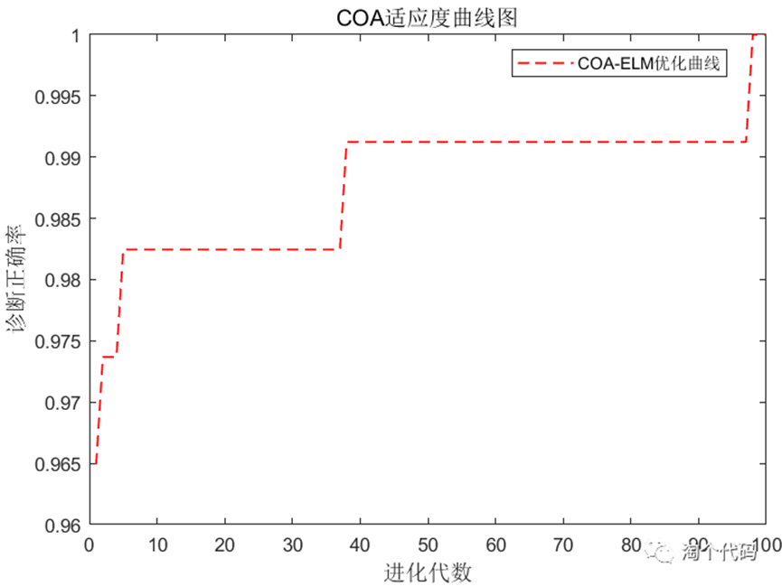

# Improved Least Squares Machine (COA-ELM) for Breast Cancer Diagnosis using the Shrimp Algorithm

This article employs the Crayfish Optimization Algorithm (COA) to optimize the Extreme Learning Machine (ELM) for data classification. This method can also be applied to other fault classification tasks.
Code directory
\n        \n  
The optimization algorithm for crayfish is a newly published algorithm in the Artificial Intelligence Review in September 2023, which has quite good convergence capability.
In this classification case, the UCI dataset was selected as the common data set.
The initial weights and thresholds of ELM (Extreme Learning Machine) are randomly generated, so they may not be optimal. An intelligent algorithm is used to optimize the weights and thresholds of ELM, making the input and output have a more perfect mapping relationship, thereby improving the accuracy of the ELM data classification model.
Classification Case:
COA-ELM's classification case uses the Wisconsin Diagnostic Breast Cancer Data (wdbc) dataset from the UCI dataset, which is divided into two categories. The classification results will be shown next.
Standard ELM Model Classification Results:
Confusion Matrix Results:
\n        \n  
Let's briefly discuss how to interpret this figure. Please look at it horizontally, and the sum of each row represents 100%. The number of data points in each row adds up to the actual number of first-class data in the test set. Taking the first row as an example, there are 67 data points in the test set that belong to the first category. Among these 67 data points, 65 were correctly predicted, and 2 were misclassified into the second category. This interpretation applies to all other rows.
The following figure is another way of presenting results, which is sometimes used in papers.
\n        \n  
COA-ELM classification result:
\n        \n  
\n        \n  
\n        \n  
03 Code Display
% Initialize clearclose allclcwarning off
addpath(genpath(pwd));load wdbc.mat; data = WDBC; data = data(randperm(size(data,1)),:); % This line of code is used to permute the original samples, so that both training and testing sets are randomly selected, which helps in updating prediction results. input = data(:,2:end); output = data(:,1); %% Splitting training set and test set m = fix(size(data,1)*0.8);% Number of training samples % Training set input_train=input(1:m, :)'; output_train=output(1:m, :)'; % Test set input_test=input(m+1:end, :)'; output_test=output(m+1:end, :)'; %% Data normalization [inputn, inputps]=mapminmax(input_train, 0, 1); inputn_test=mapminmax('apply', input_test, inputps); % Test set %% Hidden layer nodes % No ELM network before optimization. Build an ELM classifier and predict the standard ELM network: activation='sin'; [IW, B, LW, TF, TYPE] = elmtrain(inputn, output_train, hiddennum, activation, 1); Tn_sim = elmpredict(inputn_test, IW, B, LW, TF, TYPE);test_accuracy=(sum(output_test==Tn_sim))/length(output_test);% Plot figureset(gca,'looseInset',[0 0 0 0])stem(output_test,'*')hold onplot(Tn_sim','p')xlabel('Sample','fontsize',12,'fontname','TimesNewRoman');ylabel('Label Value', 'fontsize', 12, 'fontname', 'TimesNewRoman'); title(['Standard ELM classification accuracy:', num2str(test_accuracy*100), '%'], 'fontsize', 12, 'fontname', 'TimesNewRoman'); legend('Actual value', 'Predicted value', 'fontsize', 12, 'fontname', 'TimesNewRoman');% Draw a box plot confMat = confusionmat(output_test, Tn_sim'); %output_test is the real value label figure; set(gca, 'looseInset', [0 0 0 0])% set(gcf, 'unit', 'centimeters', 'position', [5 2 23 15])zjyanseplotConfMat(confMat.'); xlabel('Predicted Label', 'fontsize', 12, 'fontname', 'TimesNewRoman');ylabel('True Labels', 'fontsize', 12, 'fontname', 'TimesNewRoman');
title(['Standard ELM Classification Accuracy:', num2str(test_accuracy * 100), '%'], 'fontsize', 12, 'fontname', 'TimesNewRoman');
hold off %% COA optimization for ELMTYPE=1;[Alpha_score,bestchrom,trace]=COA(inputnum,hiddennum,TYPE,activation,inputn,output_train,inputn_test,output_test);% PSOCHOA%% Optimized Results Analysis Figureset(gca, 'looseInset', [0 0 0 0])plot(1-trace, 'r--', 'linewidth', 1) legend('COA-ELM optimization curve') title('COA fitness curve graph', 'fontsize', 12, 'fontname', 'TimesNewRoman'); xlabel('Evolutionary Generation', 'fontsize', 12, 'fontname', 'TimesNewRoman');ylabel('Diagnostic Accuracy', 'fontsize', 12, 'fontname', 'TimesNewRoman'); x=bestchrom; %% Assign the optimal initial threshold weights to ELM for retraining and prediction [W, B1, LW, activation] = angintrain(x, inputnum, hiddennum, inputn, output_train, activation, TYPE);
The comments in the code are very detailed and easy to understand.

## Images

<!-- PAYMENT_BLOCK -->

## Get this dataset

- Payment link (Stripe): [Buy now](https://buy.stripe.com/3cs8yP7sY87d0vu9AB)
- Payment QR code: 

<!-- /PAYMENT_BLOCK -->
